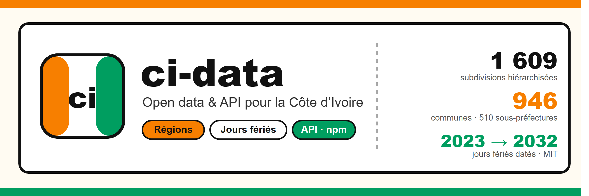
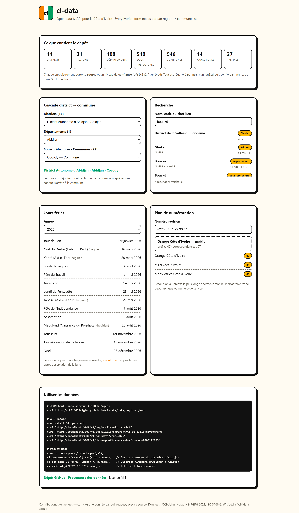

<p align="center"></p>

<h1 align="center">🇨🇮 ci-data</h1>

<p align="center">
  <b>Données ouvertes, sourcées et versionnées pour la Côte d’Ivoire</b><br>
  <b>Source-backed, versioned open data &amp; API for Côte d’Ivoire</b>
</p>

<p align="center">
  <a href="https://github.com/ck526438-lgtm/ci-data/actions/workflows/validate.yml"></a>
  <a href="LICENSE"></a>
  
  <a href="https://ck526438-lgtm.github.io/ci-data/"></a>
</p>

<p align="center"><a href="#français">Français</a> · <a href="#english">English</a></p>

---

## Français

Chaque formulaire ivoirien a besoin d’une liste **district → région → département → commune**,
d’un calendrier de jours fériés fiable et d’un plan de numérotation téléphonique. Il n’existe
aucune source propre, maintenue et ouverte pour ça. `ci-data` comble ce vide : des fichiers JSON
et CSV lisibles partout, une API Express, un paquet Node, et **une source citée sur chaque ligne**.



### Les données

| Jeu | Fichier | Contenu | Format |
|---|---|---|---|
| Découpage administratif | `data/regions.json` | **14 districts**, **31 régions**, **108 départements**, **510 sous-préfectures**, **946 communes** — avec code, parent, chef-lieu, coordonnées, superficie et population | JSON, [CSV](data/csv/regions.csv) |
| Jours fériés | `data/holidays.json` | 14 fêtes (7 fixes, 3 chrétiennes mobiles, 4 islamiques) datées de **2023 à 2032** | JSON, [CSV](data/csv/holidays.csv) |
| Plan de numérotation | `data/phone-prefixes.json` | 27 entrées ARTCI : préfixes mobiles (MTN/Moov/Orange), fixes, zones géographiques, numéros d’urgence | JSON, [CSV](data/csv/phone-prefixes.csv) |
| Schémas | `schema.json`, `data/*.schema.json` | JSON Schema draft 2020-12, validé en CI | JSON Schema |

Deux champs font la différence :

- **`source`** — obligatoire sur chaque enregistrement (`OCHA COD CIV ADM2 CI0301`, `Wikidata Q401566`,
  `INS/RGPH 2021`, `ARTCI décision n°2020-0569`…). Rien n’est inventé.
- **`confidence`** — `official` pour les 663 subdivisions reprises des sources amont, `derived` pour
  les 946 communes rattachées via Wikidata. Les `derived` sont **à confirmer avant un usage
  contractuel** : la méthode complète est décrite dans [`data/SOURCES.md`](data/SOURCES.md).

### Démarrer en 30 secondes

```bash
# 1. Sans rien installer : JSON brut hébergé par GitHub Pages
curl https://ck526438-lgtm.github.io/ci-data/data/regions.json

# 2. API locale
git clone https://github.com/ck526438-lgtm/ci-data && cd ci-data
npm install && npm start
curl "http://localhost:3000/v1/regions?level=district"

# 3. Node, hors ligne
node -e "const ci=require('./packages/js'); console.log(ci.getCommunes('CI-AB').length)"
```

### API

| Endpoint | Description |
|---|---|
| `GET /v1/meta` | version du jeu, date de génération, compteurs par niveau |
| `GET /v1/regions?level=&parent=&q=&capital=&limit=&offset=` | recherche filtrée + pagination |
| `GET /v1/regions/:code` · `/children` · `/path` | une subdivision, ses enfants, sa chaîne complète |
| `GET /v1/subdivisions?parent=&level=` | **tous** les descendants (récursif) — idéal pour un `<select>` de communes |
| `GET /v1/holidays?year=` · `?date=` · `/v1/holidays/:year` | fêtes datées, ou la fête d’un jour précis |
| `GET /v1/phone-prefixes?kind=&operator=` | le plan de numérotation filtré |
| `GET /v1/phone-prefixes/resolve?number=` | préfixe le plus long correspondant à un numéro |
| `GET /v1/stats` | compteurs par niveau et nombre de communes par district |
| `GET /data/*` | les fichiers JSON et CSV tels quels (CORS ouvert) |

```bash
curl "http://localhost:3000/v1/subdivisions?parent=CI-LG-03&level=commune"
curl "http://localhost:3000/v1/holidays?date=2026-12-25"
curl "http://localhost:3000/v1/phone-prefixes/resolve?number=%2B2250711223344"
```

### Paquets

```bash
npm install ci-data          # 🚧 à publier — en attendant : npm install github:ck526438-lgtm/ci-data
pip install ci-data          # 🚧 à venir
```

`packages/js` contient le paquet Node (zéro dépendance, types TypeScript inclus, 12 fonctions
documentées dans [son README](packages/js/README.md)).

### Reproducibilité

```bash
npm run build      # re-télécharge OCHA/humdata, Wikipédia, Wikidata, AlAdhan → régénère data/
npm run csv        # régénère data/csv/
npm run validate   # schémas JSON + intégrité de la hiérarchie + cohérence des dates
npm test           # validate + 5 suites d’assertions sur le paquet et l’API
npm run sync       # copie data/ dans packages/js/ et régénère les CSV
```

`npm run build` met tout en cache dans `.cache/` (hors dépôt) : la génération est déterministe,
les mêmes sources redonnent les mêmes fichiers. GitHub Actions exécute `npm run validate` sur
chaque push et publie la démo sur GitHub Pages.

### Contributions

Une donnée corrigée avec sa source vaut mieux qu’un issue : voir
[CONTRIBUTING.md](CONTRIBUTING.md). Les manques connus sont listés dans
[data/SOURCES.md](data/SOURCES.md) — noms non accentués côté OCHA, communes rurales de la réforme
2023, emprises polygonales, **jeux « banques » et « circonscriptions électorales » à créer**.

Licence : **MIT** (le code et les formats). Les données amont restent soumises à leurs conditions
d’usage : OCHA/humdata, INS-RGPH, ISO 3166-2, Wikipédia/Wikidata (CC BY-SA / CC0), ARTCI.

---

## English

Every Ivorian web form needs a **district → region → department → commune** cascade, a reliable
holiday calendar and a phone numbering plan — and no clean, maintained, open source provides it.
`ci-data` fills that gap: JSON and CSV files, an Express API, a zero-dependency Node package, and
**a cited source on every single record**.

### What's inside

- **1,609 administrative subdivisions** — 14 districts, 31 regions, 108 departments, 510
  sub-prefectures, 946 communes, with code, parent, capital, coordinates, area and population.
- **14 public holidays** dated **2023 → 2032** (fixed, Easter-based, and Hijri-converted).
- **27 numbering-plan entries** from ARTCI: mobile prefixes per operator, landline codes, geographic
  zones, emergency numbers.
- JSON Schema (draft 2020-12) for every dataset, CSV exports for Excel / pandas / Postgres.

Records carry `source` (never invented) and `confidence`: `official` for the 663 subdivisions taken
straight from upstream data, `derived` for communes attached through Wikidata — confirm those before
any contractual use. Method and limits: [`data/SOURCES.md`](data/SOURCES.md).

```bash
curl https://ck526438-lgtm.github.io/ci-data/data/regions.json   # no install
npm install && npm start                                          # local API on :3000
```

Rebuild everything from source with `npm run build`, check it with `npm test`, and read the live
demo at [ck526438-lgtm.github.io/ci-data](https://ck526438-lgtm.github.io/ci-data/). License: MIT.
